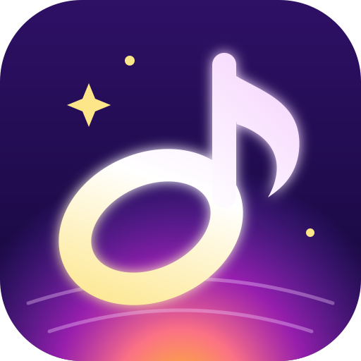

<p align="center"></p>

# Overture — learn, practise & play music

*Formerly **Cadenza**. Updating keeps all your progress, songs and classroom data.*

For piano, acoustic & electric guitar, bass (4 or 5 strings), **drums**, trumpet and singing.

Overture **listens while you play** and coaches you in real time: chords, notes, timing, strumming,
intonation, bends, tone steadiness and dynamics. Load a song (audio or MIDI), **separate the
instruments**, and play along with the full mix, a **backing track without your instrument**, or
your part on its own — or **improvise** over any track or a generated backing band. Learn with
**scales, arpeggios, technique, sight-reading, chord and ear-training modes**, play from a
**gospel & hymn library** (English, Tamil and any language) with chord charts and chord PDFs, and
**record yourself and send it to your teacher**, who reviews it by listening.
All listening and analysis run **on your device, offline**. An optional **classroom server** adds
teacher/student accounts, assignments and sync.

## Downloads

Get the latest version from the repository's **Releases** page:

| Your computer | File |
| --- | --- |
| **Windows** | `Overture-<version>-windows-setup.exe` (installer) or `Overture-<version>-windows-portable.exe` (no install) |
| **Mac** (Apple Silicon M1–M4 *and* Intel) | `Overture-<version>-mac-universal.dmg` |
| **Linux** | `Overture-<version>-linux-x86_64.AppImage` (`chmod +x`, run) or `.deb` |
| **Any computer, no install** | `Overture-web-<version>.zip` — open `index.html` in Chrome/Edge |

**First launch on a Mac:** drag Overture into Applications and open it. Because Overture isn't registered with
Apple yet, macOS says it can't verify the developer — click *Done*, then go to **System Settings → Privacy &
Security** and click **Open Anyway** (only needed once; on older macOS: right-click → Open). If macOS ever says
the app is "damaged", run `xattr -dr com.apple.quarantine /Applications/Overture.app` in Terminal. To remove the
prompt entirely, add an Apple Developer ID certificate as repository secrets (see `.github/workflows/desktop.yml`)
and the build signs and notarizes automatically.

**iPad & iPhone:** there's no App Store app; Overture installs from your classroom server's
`https://` address in Safari → **Share → Add to Home Screen**. It then runs full-screen, offline,
stays signed in and syncs. The app shows these steps itself. See **[docs/HOSTING.md](docs/HOSTING.md)**
to put your server online (Render.com, your own server with Docker, or your computer + Cloudflare Tunnel).
USB MIDI keyboards aren't supported on iPad/iPhone (use the microphone).

**First launch on Windows:** if SmartScreen appears, click **More info → Run anyway**.

Builds come from the *Build desktop apps* GitHub Action, which launches every packaged app on its own OS before
publishing. Push a tag like `v2.0.1` to publish a release, or run the workflow manually from the Actions tab.
Local builds: `cd desktop && npm install && npm run dist:mac` (or `dist:win`, `dist:linux`).

## Features

| Area | What it does |
| --- | --- |
| **Real instrument sounds** | Every note you hear is a physically modelled instrument, not a beep: hammered piano strings (inharmonic partials, 1–3 detuned strings, hammer noise), plucked acoustic guitar with a wooden body, electric guitar through an amp, finger-style bass, trumpet (lip scoop, bell, breath, vibrato), a four-part choir (formant singers), bowed strings, drawbar organ and a full acoustic drum kit — with room reverb. Rendered on the device, offline. |
| **Drums** | A new instrument and **Drum Studio**: a playable kit (touch, mouse or keyboard) with a loop recorder, groove library (rock to odd meters), rudiments with sticking, classic fills, a fresh-fill generator and groove remixes, drum-grid notation with counts, and timing scored per hit — from a microphone on a real kit, or with tap pads that also check the right drum. A 56-exercise drum path, a 12-lesson drums course and a drum lane in the Play-Along Studio. |
| **Note lengths** | Every instrument's path has a *Note lengths* track: whole, half, quarter, eighth and sixteenth notes, dotted notes, triplets, syncopation and a mixed rhythm study. |
| **Tip of the day & Did you know?** | A new practice tip (mixed with tips for your instrument) and a music fact on Home every day. |
| **7 instruments** | Piano, acoustic guitar, electric guitar, **drums**, bass guitar (**4- or 5-string**, down to low B 31 Hz — fretboards, tuner and exercises follow your choice), B♭ trumpet (written pitch, valve fingerings) and **voice** (soprano, mezzo, alto, tenor, baritone, bass). Each has its own fretboard/keyboard/valve/pitch-trail view, tuner, tips and coaching focus. |
| **Fingering guide** | A piano roll plus fretboard, keyboard or valve view for every exercise and for the song melody in the Play-Along Studio: piano finger numbers for either hand (thumb-under, finger-over), guitar/bass string-fret-finger (open position, up the neck, 1-2-4 bass fingering), trumpet valves with alternate fingerings — recommended fingering first, alternatives one tap away, following playback. |
| **Click patterns** | A step-sequencer for custom metronome loops: tap steps for accent / click / soft / rest, any beats, steps per beat (up to sextuplets) and bars, swing, 21 presets (clave, tresillo, 6/8, 5/4, 7/8, gap trainers), random patterns by level, tempo ramp, silent-loop trainer, saved patterns and shareable codes. |
| **Instrument courses** | 60 interactive Academy lessons — piano, guitar, bass, trumpet and singing at Beginner, Intermediate and Advanced — with fingering guides, tap-to-hear fretboards and keyboards, a valve simulator, play-it-now mic drills and instrument questions (fretboard, tab, finger numbers, inversions, valves, partials, bass lines, voice types) that change every time. |
| **Challenge Arena** | 66 creative challenges, 22 at each level: ear duels, beat-the-clock sprints, three-lives survival, tap-back rhythms, Simon-style melody memory, keyboard and fretboard hunts and ordering puzzles — with fresh questions every play, stars and best scores. |
| **Singing** | 65 graded vocal exercises pitched for your voice type: breathing, lip trills, humming, sirens, scales rising by semitones, arpeggios, octave leaps, messa di voce, agility runs, gospel/R&B riffs, harmony lines, solfege sight-singing, Carnatic sarali & janta varisai and sing-alongs. A **pitch trail** shows your voice against the melody; takes get an intonation score (±cents, sharp/flat tendency); a **karaoke mix** mutes the vocals; Insights suggests the best key for your voice. |
| **Live Studio** | Real-time coaching via mic, audio interface (line-in) or MIDI device: chord/note matching, next-chord countdown with fingering, harmony radar, timing (rushing/dragging in ms), intonation in cents, dynamics vs. the song, score/combo/accuracy, coach feed. Slow-down without pitch change, loops, count-in. Jump by section or chord (`[` `]`, `1`–`9`), switch saved tracks from the header, and a floating mini transport while you scroll. |
| **Instrument separation** | Split an audio song into **7 stems — vocals, guitars & piano, pads & strings, bass, kick, snare and cymbals** — on-device (STFT soft-mask HPSS with a sustain floor, stereo-centre + melody-guided comb mask for vocals, bass band, percussive flatness for snare vs cymbals; stems always sum back to the original). MIDI files separate **exactly** by instrument. Presets: *Full song · Backing track (no my instrument) · My part only · Drums & bass*, plus per-stem mute/solo/volume. |
| **Part following** | For bass and trumpet the coach follows your isolated part (exact from MIDI, transcribed from audio stems) — or the chord roots/chord tones when no part exists. |
| **Improvise mode** | Chord-scale suggestions for every chord (pentatonic, modes, blues…), chord tones & scale tones mapped on the fretboard/keyboard, live note classification (chord / scale / blue / outside), praise for targeting 3rds & 7ths on changes, clash warnings with resolution hints, range/rhythm/phrasing feedback and creative prompts. |
| **Backing-track generator** | Any key; pop, ballad, 12-bar blues, jazz ii–V–I, minor, funk and Dorian progressions; rock, swing, ballad and funk grooves; any tempo. Generated **without your instrument**. |
| **Song Insights** | Key, tempo, time signature, song map (intro / verse / chorus), chord progression with roman numerals and inversions (C/E…), melody line with passing notes, strumming vs finger-picking, chord shapes (guitars), bass roots & positions, trumpet written-key chart, strumming pattern, dynamics chart and a practice plan. |
| **Electric guitar** | Power chords, bend measurement (half/whole-step accuracy in cents), muting tips. |
| **Trumpet** | Written-pitch display with valves, transposed instructions, tone-steadiness (wobble) detection, Long Tones challenge. |
| **Metronome & tuner** | Accents, subdivisions, odd meters, speed & gap trainers, timing check; chromatic tuner with per-instrument strings and B♭ transposition. |
| **Learn** | Scales (major, minors, pentatonics, blues, modes; 1–2 octaves, any key), arpeggios, instrument-specific technique (five-finger & Hanon-style, chromatic 1-2-3-4, root–fifth, lip slurs…), sight-reading on the staff, note-names quiz, chord library + one-minute changes, interval ear training, call & response (echo & improvised answers), progression builder → jam with a band. The coach listens and moves on with you; slips are reported. |
| **Worship library & tutorials** | Bethel Music, Hillsong and contemporary worship **chord charts** (practice arrangements in playable keys — lyrics aren't included for copyrighted songs; check the official chart and use your CCLI licence), public-domain hymns **with words**, and **Tamil worship practice patterns** (Keharwa, Thappu 6/8, ஆராதனை, prayer song, carol, Carnatic raga colour). Every song has a **guitar & piano tutorial**: strumming & picking patterns, capo options, hardest change, voice-led piano voicings and inversions, hand patterns, step-by-step checklist, dynamics roadmap and a matching drum groove. *Make my copy* to edit or add words. |
| **Academy** | 53 self-paced lessons in 12 subjects (fundamentals, reading, rhythm, scales & keys, intervals, chords & harmony, ear training, songwriting, improvisation, worship band & arranging, practice skills, your instrument), Beginner → Advanced. Each lesson: explanation, real-world uses, examples to hear, "on your instrument" panel, unlimited generated practice (43 question types) with mastery stars, links to practise it — plus a placement quiz. |
| **Music Toolkit** | Chord dictionary, scale finder (with fret positions), interactive circle of fifths, chord-chart transposer & capo calculator, and a glossary of 80 terms. |
| **Practice Planner** | Balanced daily routines for your time and focus with a guided timer per block and a weekly tracker. |
| **Harmony & parts** | A six-step harmony path and a **SATB part trainer** for public-domain hymns and rounds: listen to all parts, your part alone, or sing your part while Overture sings the rest — scrolling four-colour score, chord and chord-tone of every voice, words, live pitch line and in-tune score. Overture's own four-part arrangements (rule-based voice leading). |
| **Kids & Focus** | Designed with **ADHD and autistic** children and teens in mind: 48 two-to-four-minute lessons (rhythm, piano, guitar, singing), one instruction at a time with progress dots and read-aloud, colour-coded notes, tap-along and echo rhythms, ear games, chord shapes, microphone checks with an "I did it" fallback, **visual timers**, a first-then daily plan, an always-available **break button** (breathing bubble, wiggle and squeeze breaks), gentle never-red feedback, relaxed timing, a buddy and a **sticker book**. |
| **Appearance** | 8 colour themes (violet, ocean, forest, sunset, rose, sunshine, slate, high contrast), light / dark / auto, **Avenir Next** (bundled open-licence Nunito Sans on devices without it), **Atkinson Hyperlegible** and **Lexend** reading fonts, text size, letter spacing and **calm mode** (no motion or confetti). |
| **Songs** | Public-domain hymns & spirituals built in; teachers add songs in **English, Tamil or any language** (ChordPro or chords-over-lyrics) with **chord PDFs**, images and audio. Transpose, capo, text size, auto-scroll, chord diagrams for your instrument (B♭ chords for trumpet), a generated **backing band in the song's meter** whose lyrics highlight as it plays, and **record & send for review**. |
| **Recordings & review** | Record with or without the backing track, listen back, add a note, send (queued offline, uploads later). Teachers listen in **Results**, give 1–5 stars, a pitch/timing/tone/expression rubric and comments, or **ask to try again**. |
| **Exercise path** | 65–70+ graded exercises per instrument (Level 1 → 5): first notes, pulse, scales in many keys, arpeggios, melodies, rhythms, intervals, modes, 7th arpeggios, ii–V–I chord tones, chord changes and instrument technique. Play along with count-in and click — every note is judged for pitch and timing — or use *Wait for me*. Stars and progress sync. |
| **Takes & playback** | Every play-along take is recorded: play it back, hear it **with the reference**, compare takes (accuracy, timing ±ms) and send the best to your teacher. |
| **Rhythm styles** | 41 arranger-keyboard style rhythms (pop/worship ballads, soft & hard rock, disco, funk, house, hip-hop, reggae, bossa, samba, cha cha, tango, swing, jazz waltz, country, waltzes, gospel 12/8, 6/8 worship, bhangra, keherwa, dadra…) with Intro, Main A/B, Fill, Ending and auto-accompaniment (bass + chords) following the chords you type. |
| **Beat maker** | Step sequencer & pattern builder: 18 synthesized drum voices, 16th/8th/triplet/3/4/6/8/5/4/7/8 grids, accents, ghost notes, swing, save/load, start from a style. **Rhythm practice** scores your claps/strums against any drum part. |
| **Cadi — practice coach** | Built-in, offline coach: live comments while you play (rushing/dragging, repeated wrong notes, streaks), take reviews and comparisons, practice plans from your history, and answers to music questions (chords for your instrument, scales, intervals, time signatures, tempo words, technique). Optional spoken tips. |
| **Challenges** | Chord Quest, Rhythm Hero, Note Hunter (per-instrument ranges), Long Tones, Ear Trainer. |
| **Gamification** | XP, levels, streaks, daily challenges, 21 badges (incl. Improviser & Homework Hero), stars, history. |
| **Classroom** | Master teacher, teachers & students; invite codes; **custom assignments** (instructions + PDFs/audio + required recording), song-library and Learn assignments, play-along/improvise/challenge assignments with mix, speed, targets and due dates; results with coach insights; listening review; synced progress. |

## Classroom: users, assignments and sync

### 1. Start a classroom server (teacher)

Pick one:

* **Desktop app** — *Classroom → Host classroom on this computer → Start*. It shows the address students use, e.g. `http://192.168.1.20:8787`.
* **Any computer with Node.js 18+** — `node server/server.js` (or `Start Classroom Server` in the web zip). Data is stored in `server-data/` (`DATA_DIR` to change, `PORT` to change the port).
* **Online for free (students at home & iPads)** — in the desktop app, after *Start*, click **Put online** under *Students at home*: Overture opens a Cloudflare Tunnel and shows an `https://` address to share (see [docs/HOSTING.md](docs/HOSTING.md), option C).
* **Online on a server** — deploy `server/server.js` to any Node host with a persistent disk (a small VPS, Render, Railway, Fly.io…) and put it behind HTTPS (e.g. Caddy: `music.example.com { reverse_proxy localhost:8787 }`, or set `TLS_CERT`/`TLS_KEY`). Students then use `https://music.example.com`.

### 2. Become the master teacher

Open Overture → **Classroom**, enter the server address. On a brand-new server you'll see
*Set up as master teacher*: choose your school name, username and password. The master teacher can
add other teachers (and other master teachers); teachers manage students.

### 3. Add students (two ways)

* **Create the account yourself**: *Students → Add a student* (name, username, instrument). Overture shows a
  temporary password — give it to the student with the server address. They choose their own password at first sign-in.
* **Invite codes**: *Invite codes → Generate*. Send each student a code; they pick *I have an invite code*,
  enter the server address and code, and choose their own username & password.

You can reset passwords, deactivate or delete accounts, and open any student to see their level,
streak, practice history and assignment results.

### 4. Set assignments

*Assignments → New assignment*: title, instructions, instrument (or any), practice mode
(*custom task · song from the library · Learn activity · play the part · improvise · challenge game · free practice*), attachments (chord PDFs, sheet music, audio), *student must send a recording*, mix (*full song · backing track ·
own part only · drums & bass*), speed, targets (accuracy %, minutes, stars), due date, and who it's
for (everyone or chosen students). Attach a **song file**, the **current Studio track**, or a
**generated backing track** (each student gets it without their own instrument).

Students see assignments in **Classroom**, press **Start**, and Overture opens the Studio (or the
challenge) with everything set up. When they finish a session the result — accuracy, minutes,
stars and the coach's insights — is sent to the teacher. Recordings appear in **Results** with a
*Listen* button; the teacher gives stars, rubric scores and comments, or sends it back to try
again. Students see the review under **My recordings & reviews**.

### 5. Install on students' computers and stay in sync

Send students the installer (or the web zip). They install it, open **Classroom**, enter the server
address and sign in. Everything works **offline**; results wait in an outbox and upload, and
XP/levels/badges/history merge across devices (conflict-free), whenever the server is reachable.

> **Microphone note:** browsers only allow the microphone on `https://` sites, `localhost` and local
> files. The installed desktop app and the downloaded web app always work. Opening the app *in a
> browser* from another computer's `http://192.168…` address does not allow the mic — use the
> desktop app or serve the classroom over HTTPS.

## Running from source

```bash
npm start        # app at http://localhost:5173 (static server, zero dependencies)
npm run server   # classroom server at http://localhost:8787 (also serves the app)
npm test         # unit + integration tests (incl. an analyser accuracy floor)
node scripts/bench-analyzer.js 30 [--midi]   # analyser accuracy report on synthetic songs with ground truth
npm run package:web   # dist/Overture-web-<version>.zip
cd desktop && npm install && npm start   # desktop app in development
```

## How the "AI" works (all on-device)

- **Pitch:** YIN with parabolic interpolation (decimated for bass down to 35 Hz).
- **Chords:** harmonic-aware chroma (overtones credited to their fundamental) → template matching (10 qualities × 12 roots) with inversion-aware bass scoring and a key prior → Viterbi smoothing over beats → segment-level quality refinement (e.g. A → A7) → voicing & inversion labels (C/E, 1st/2nd inversion, top note, spread).
- **Key:** Krumhansl–Kessler profiles refined by chord evidence — diatonic share, tonic share, cadences, first & last chord (resolves relative major/minor).
- **Melody & picking:** salience-and-continuity melody tracking with passing notes; strumming vs finger-picking from new notes per attack (and Travis-pattern hints).
- **Sections:** 4-bar phrases grouped by chord sequence, loudest repeated part = chorus.
- **Tempo/beats/meter:** spectral-flux novelty, autocorrelation with tempo prior, dynamic-programming beat tracker, accent-periodicity meter with compound-meter detection.
- **Strumming:** grid quantisation + low-to-high pitch-sweep direction + hand-motion priors.
- **Separation (7 stems):** harmonic/percussive median filtering, a sliding-minimum sustain floor for pads, melody-guided comb + stereo-centre masks for vocals, a bass band, kick/snare/cymbals from percussive band energy and spectral flatness — on a packed stereo STFT with perfect-reconstruction overlap-add.
- **Transcription:** monophonic YIN tracking with median smoothing and re-attack detection (bass lines, melodies).
- **Improvisation:** chord-scale selection by key fit, note classification, targeting detection, inter-onset rhythmic entropy, range and space metrics.
- **Synthesis:** additive piano, Karplus–Strong guitar/electric/bass, wavetable brass/strings/organ/voice and a synthesized drum kit.

These are signal-processing methods, not neural networks: separation is approximate on dense
real-world mixes (MIDI is exact), and all results are best treated as a practice guide.

## Project layout

```
index.html, css/, icons/, sw.js, manifest.webmanifest, serve.js
js/core/     dsp · theory · instruments · rhythm · midi · analyzer · separation · improv · backing · coach · game · syncmerge · songs · learn · curriculum · styles · agent
js/audio/    AudioContext + player + IndexedDB library · live mic/MIDI engines · metronome · recorder · drums (kit, step sequencer, accompaniment)
js/sync/     classroom account, outbox & progress sync client
js/ui/       components (keyboard, fretboard, valves, chord diagrams, timeline, radar, charts) · PDF/attachment viewer · record panel · play-along trainer · Cadi coach panel
js/views/    home · studio · songs · learn · rhythm (styles & beat maker) · insights · games · metronome · tuner · progress · classroom
vendor/      pdf.js (Apache-2.0) for chord-sheet PDFs, offline
server/      zero-dependency classroom server (accounts, invites, assignments, files, results, sync)
desktop/     Electron shell (offline app + "Host classroom" + Cloudflare Tunnel), electron-builder config
scripts/     packaging helpers
tests/       node --test suites (synthetic songs, separation, coaching, server)
```
